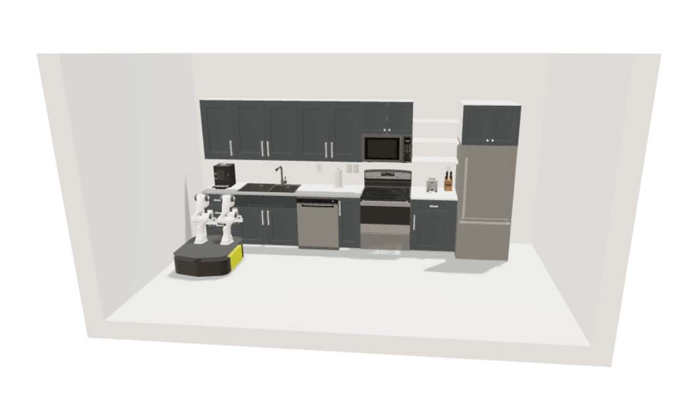

# Ridgeback Environment
This repository contains all code necessary to run the Clearpath Robotics Ridgeback mobile base both in real life and in sim. It also has support for attached robot arms, such as the Franka Emika Panda arms and a selection of UR models.

## Setup
This project uses `uv` for dependency management. Run the following command to install `uv`:
```bash
curl -LsSf https://astral.sh/uv/install.sh | sh
```

This project also uses submodules. Ensure that you initialize all submodules via the following:
```
git submodule update --init --recursive
```

Verify that your setup works by running the robocasa demo with the Ridgeback Dual Panda configuration:
```bash
cd src
uv sync
uv run python3 -m robocasa.demos.demo_kitchen_scenes --robot RidgebackDualPanda --layout 1 --style 1
```
This defaults to an mjviser visualization that should look like the following. Note that it may take a minute for the kitchen environment to be visualized in mjviser.


For local visualization using mujoco's native viewer (which enables teleop control and loads faster), add the argument `--renderer mjviewer`.

## References
- https://github.com/ridgeback/ridgeback
- https://github.com/ridgeback/ridgeback_manipulation
